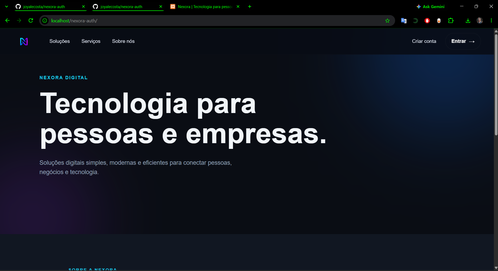

# Nexora Auth

Sistema de autenticação e portal demonstrativo de clientes desenvolvido como parte da **Nexora Serviços Digitais**, integrante do ecossistema **Ada's Legacy**.

## Preview



## Sobre o projeto

O **Nexora Auth** é uma aplicação web desenvolvida em PHP e MySQL para demonstrar um fluxo de autenticação, gerenciamento de sessões e acesso a uma área restrita.

O projeto integra meu portfólio de desenvolvimento web e representa a aplicação prática de conceitos de back-end, banco de dados e segurança de aplicações.

### Funcionalidades

- Cadastro de usuários
- Login com e-mail e senha
- Armazenamento seguro de senhas com hash
- Gerenciamento de sessões PHP
- Dashboard protegido por autenticação
- Exibição de dados da conta
- Página demonstrativa de acompanhamento de serviços
- Logout por requisição POST
- Interface responsiva

## Tecnologias

- HTML5
- CSS3
- PHP
- MySQL
- PDO (PHP Data Objects)
- Git e GitHub
- XAMPP (ambiente de desenvolvimento local)

## Medidas de segurança implementadas

- Hash de senhas com `password_hash()`
- Verificação de senhas com `password_verify()`
- Consultas parametrizadas com PDO
- Tokens CSRF em formulários protegidos
- Validação de tokens com `hash_equals()`
- Renovação do identificador de sessão após login
- Limitação de tentativas de login por IP e e-mail, com janela de 15 minutos
- Escape de dados exibidos com `htmlspecialchars()`
- Arquivo local de credenciais excluído do versionamento Git

**Nota:** Essas medidas reduzem riscos conhecidos, mas não substituem testes especializados ou uma auditoria de segurança antes da utilização em produção.

## Requisitos

- PHP com extensão PDO MySQL habilitada
- MySQL ou MariaDB compatível
- Servidor web com suporte a PHP
- XAMPP para execução local (opcional)

## Instalação local com XAMPP

1. Abra o terminal e clone o repositório na pasta `htdocs`:

   ```powershell
   cd C:\xampp\htdocs
   git clone https://github.com/joyalecosta/nexora-auth.git
   ```

2. Inicie o Apache e o MySQL pelo painel do XAMPP.

3. Importe `database/schema.sql` pelo phpMyAdmin para criar o banco `nexora_auth` e suas tabelas.

4. Copie o arquivo `config/database.example.php` para `config/database.php`.

5. Configure as credenciais do MySQL em `config/database.php`.

6. Acesse no navegador:

   `http://localhost/nexora-auth/`

## Estrutura principal

```text
nexora-auth/
├── assets/
│   ├── css/
│   └── img/
├── config/
│   └── database.example.php
├── database/
│   └── schema.sql
├── docs/
│   └── screenshots/
├── dashboard.php
├── index.php
├── login.php
├── logout.php
├── register.php
├── service.php
├── .gitignore
└── README.md
```

O arquivo `config/database.php` deve ser criado localmente e não deve ser enviado ao repositório.

## Banco de dados

O projeto utiliza duas tabelas principais:

**users**

Armazena os dados dos usuários cadastrados, incluindo o hash da senha.

**login_attempts**

Registra tentativas de login utilizadas pelo mecanismo de limitação de tentativas.

O arquivo `database/schema.sql` contém a estrutura necessária para criar as tabelas, sem dados pessoais de usuários.

## Limitações atuais

- O acompanhamento de serviços utiliza informações demonstrativas.
- A recuperação de senha ainda não foi implementada.
- O projeto foi desenvolvido e testado inicialmente em ambiente local.
- A implantação pública exige HTTPS, proteção de credenciais e revisão adicional de segurança.

## Próximas melhorias

- Recuperação de senha por e-mail
- Melhorias no tratamento de erros
- Aprimoramento da acessibilidade
- Evolução do portal do cliente
- Testes automatizados
- Deploy em servidor Linux

## Autora

**Joyce Costa**

Projeto desenvolvido para estudo de desenvolvimento web back-end e composição de portfólio profissional.

GitHub: https://github.com/joyalecosta
